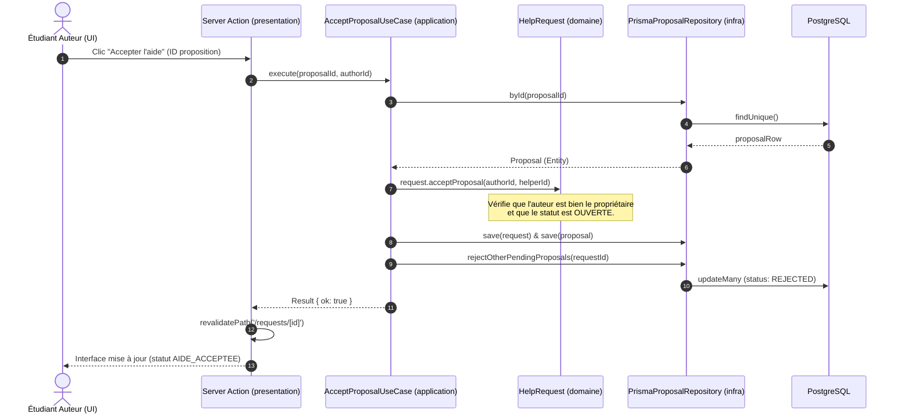

# Documentation de l'Architecture : CampusConnect 🏛️

> **Justification des choix de conception et guide d'architecture Clean Architecture**  
> Conformément au cours avancé et aux travaux pratiques de **M. Mohamed Amine Ben Rhouma** (*Clean Architecture avec Next.js & TypeScript*).

---

## 1. Vue d'ensemble & Justification du choix architectural

### 1.1 Pourquoi la Clean Architecture ?
Dans une application Next.js traditionnelle, il est courant de voir les requêtes Prisma, les validations de formulaires et les règles de gestion mélangées directement dans des composants React ou des fichiers de route. 

Ce couplage direct présente des défauts majeurs :
- **Impossibilité de tester le métier isolément** sans démarrer une base de données ou un serveur HTTP.
- **Règles métier dispersées et dupliquées** entre l'UI, les actions serveur et les scripts.
- **Couplage fort à l'ORM et au framework**, rendant toute migration technologique coûteuse.

La **Clean Architecture** résout ce problème en séparant clairement :
1. **Ce que fait l'application** (Le Domaine et les Cas d'utilisation).
2. **Comment les données sont stockées et affichées** (L'Infrastructure PostgreSQL/Prisma et la Présentation Next.js).

### 1.2 Pourquoi une architecture monolithique unifiée (Sans Monorepo) ?
Le sujet de TP 1 précise :  
> *"Clean Architecture = séparation des responsabilités + dépendances vers les abstractions. Ce TP n’est pas un monorepo : les deux concepts sont étudiés séparément."*

Pour une application ciblée comme CampusConnect, une structure en dossiers (`src/domain`, `src/application`, `src/infrastructure`, `src/container`, `src/app`) offre l'intégralité des garanties de découplage de la Clean Architecture sans la surchage opérationnelle d'un monorepo Turborepo (pas de multiplication des `package.json`, pas de publication interne, temps de build optimisé).

---

## 2. Les Quatre Cercles & La Règle de Dépendance

```text
               ┌──────────────────────────────────────────────┐
               │              PRÉSENTATION                    │
               │   Next.js App Router, Server Actions, UI     │
               │  ┌────────────────────────────────────────┐  │
               │  │           INFRASTRUCTURE               │  │
               │  │    PostgreSQL, Prisma, JWT, Bcrypt     │  │
               │  │  ┌──────────────────────────────────┐  │  │
               │  │  │          APPLICATION             │  │  │
               │  │  │      Cas d'utilisation, Ports    │  │  │
               │  │  │  ┌────────────────────────────┐  │  │  │
               │  │  │  │           DOMAINE          │  │  │  │
               │  │  │  │   Entités pures, Invariants│  │  │  │
               │  │  │  │   Erreurs métier, Règles   │  │  │  │
               │  │  │  └────────────────────────────┘  │  │  │
               │  │  └──────────────────────────────────┘  │  │
               │  └────────────────────────────────────────┘  │
               └──────────────────────────────────────────────┘
```

### La Règle Fondamentale :
> **Une couche interne ne connaît JAMAIS le nom ni l'existence d'une couche externe.**
> - Le **Domaine** n'importe ni Next.js, ni React, ni Prisma, ni Zod. Il est pur TypeScript.
> - L'**Application** ne dépend que du Domaine et déclare ses besoins via des **Ports (interfaces)**.
> - L'**Infrastructure** implémente ces ports via des adaptateurs (Prisma, Bcrypt, JWT).
> - La **Présentation** appelle les cas d'utilisation via le Composition Root.

---

## 3. Détail des Couches

### 3.1 Couche Domaine (`src/domain/`)
Elle contient les entités porteuses de règles et d'invariants :
- **Entité `User`** : Gère l'identité étudiante, le calcul dynamique des points de réputation et l'attribution des badges (*Tuteur Actif*, *Mentor Campus*, *Excellence Académique*).
- **Entité `HelpRequest`** : Modélise le cycle de vie de la demande (`OPEN` ➔ `ACCEPTED` ➔ `COMPLETED`).
  - *Invariants stricts* : Seul l'auteur peut modifier la demande ou accepter une proposition.
  - Une demande clôturée ne peut plus recevoir de propositions.
  - Seuls les participants peuvent déclarer une séance terminée.
- **Entité `Proposal`** : Modélise les candidatures d'aide, avec interdiction pour l'auteur de postuler sur sa propre demande.
- **Entité `SessionReview`** : Borne stricte de la note (1 à 5 étoiles) et vérification que la séance est bien clôturée avant tout avis.
- **Entité `Report`** : Signalement modérateur.
- **Objets Valeur (Value Objects)** : `UserId`, `HelpRequestId`, `ProposalId`, `ReviewId`, `ReportId` garantissent des identifiants valides et typés.
- **Erreurs Typées du Domaine** : `ActionNonAutoriseeError`, `DemandeDejaClotureeError`, etc., portant un code d'erreur textuel unique.

### 3.2 Couche Application (`src/application/`)
Elle orchestre les scénarios fonctionnels sans connaître la technique :
- **Ports (`src/application/ports/`)** : Interfaces déclarant les opérations requises :
  - `UserRepository`, `HelpRequestRepository`, `ProposalRepository`, `SessionReviewRepository`, `ReportRepository`.
  - `PasswordHasher`, `TokenService`.
  - *Vocabulaire métier exclusif* : `byId`, `byEmail`, `save`, `all` (jamais de `findMany`, `upsert` ou de types de base de données).
- **Cas d'Utilisation (`src/application/use-cases/`)** :
  - Reçoivent des DTOs primitifs en entrée.
  - Invoquent les méthodes riches des entités du domaine.
  - Utilisent les ports injectés.
  - Retournent un type `Result<T>` (`{ ok: true, value }` ou `{ ok: false, code, message }`) prévisible et sérialisable pour l'UI.

### 3.3 Couche Infrastructure (`src/infrastructure/`)
Elle s'adapte aux technologies réelles :
- **Dépôts Prisma (`src/infrastructure/repositories/`)** : Implémentent les interfaces de l'application via `@prisma/client`.
- **Mappers Bidirectionnels (`src/infrastructure/mappers/`)** :
  - `toDomain(row: PrismaRow): Entity`
  - `toPersistence(entity: Entity): PrismaRowData`
  - **Évite toute fuite** : Le type `@prisma/client` reste strictement confiné à l'infrastructure.
- **Sécurité** : `BcryptPasswordHasher` et `JwtTokenService`.

### 3.4 Composition Root (`src/container/index.ts`)
Un seul fichier assemble les implémentations concrètes :
```typescript
// Instanciation des adaptateurs techniques
const userRepository = new PrismaUserRepository();
const helpRequestRepository = new PrismaHelpRequestRepository();
const proposalRepository = new PrismaProposalRepository();
const reviewRepository = new PrismaSessionReviewRepository();
const passwordHasher = new BcryptPasswordHasher();
const tokenService = new JwtTokenService();

// Injection dans les cas d'utilisation
export const useCases = {
  createHelpRequest: new CreateHelpRequestUseCase(helpRequestRepository, userRepository),
  acceptProposal: new AcceptProposalUseCase(proposalRepository, helpRequestRepository, userRepository),
  // ...
};
```
La couche présentation n'a besoin d'importer que l'objet `useCases`.

---

## 4. Le Flux Complet d'une Requête

Exemple : Acceptation d'une proposition d'aide par l'auteur d'une demande.



---

## 5. Validation aux Frontières vs Règles Métier

Comme préconisé dans le cours (slide 34-35) :
1. **Aux frontières (Schémas Zod)** : Vérification de la forme brute (types, longueurs minimales, format email).
2. **Dans le Domaine (Entités)** : Vérification des règles d'intégrité et droits métier (statuts autorisés, incompatibilité de rôles, calcul des points).

Cette double vérification assure la robustesse du système tout en conservant une séparation étanche des responsabilités.
